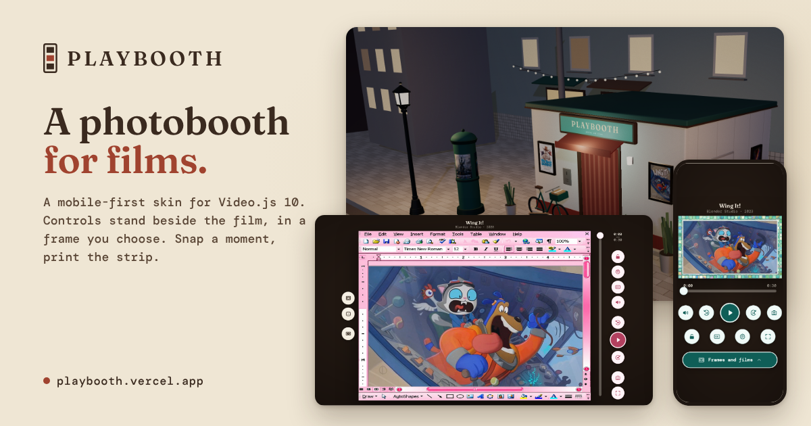
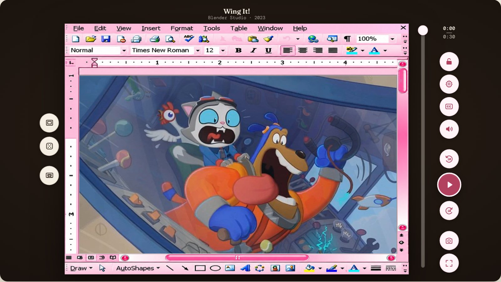
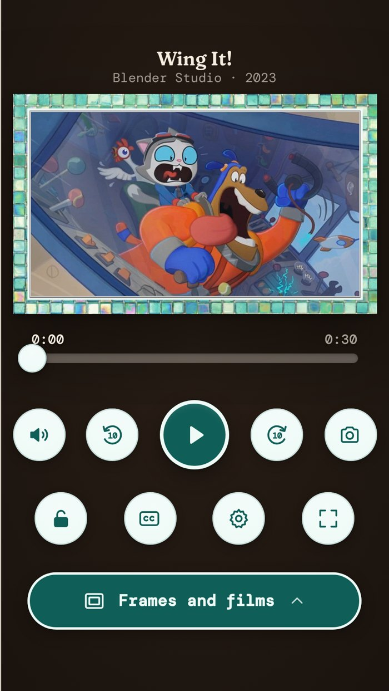
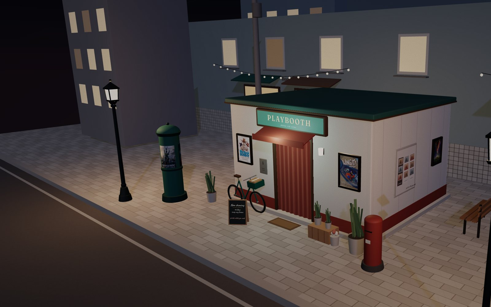

# PLAYBOOTH

<p align="center">
  <a href="https://playbooth.vercel.app"></a>
</p>

**A photobooth for films, and a mobile-first Video.js 10 skin.**

A photobooth is a little room you step into. PLAYBOOTH is one made for **play**, both kinds. **Play the game**: walk down a quiet street, step into the booth, pick a tape off the shelf and slide it into an old VCR. **Play the film**: watch it in a photo frame you choose, snap the moments you love, and print them as a photostrip.

The player inside the booth is a complete Video.js 10 skin that also stands on its own and drops into any React page.

| | |
| --- | --- |
| The booth | https://playbooth.vercel.app |
| The player on its own (sizes, frames, light and dark page) | https://playbooth.vercel.app/player/ |
| The player on an ordinary page | https://playbooth.vercel.app/embed/ |
| Source | https://github.com/ruffasakay/playbooth |

Built with Video.js 10.4 (`@videojs/react`), React 19, React Three Fiber and three.js; the films are hosted and streamed on [Mux](https://www.mux.com). Apache License 2.0.

---

## Contents

- [The idea](#the-idea)
- [Features](#features)
- [Use the player on your site](#use-the-player-on-your-site)
- [Getting started](#getting-started)
- [How it works](#how-it-works)
- [Keyboard and touch](#keyboard-and-touch)
- [Accessibility](#accessibility)
- [Project structure](#project-structure)
- [Films](#films)
- [Credits and license](#credits-and-license)
- [Known limitations](#known-limitations)

---

## The idea

### Controls for thumbs

Hold a phone sideways and your thumbs rest on its short edges, not along the bottom. Most players still put their controls in a strip along the bottom, over the film. PLAYBOOTH stands them up beside the picture instead:

- **Right thumb**: a vertical progress bar and one column of keys (play, ±10 s, sound, captions, settings, lock, snap, full screen).
- **Left thumb**: the booth's own keys (back, snaps, album, eject), or, outside the booth, frames and films.
- **Nothing sits on the film.** The framed picture takes every pixel between the two.
- Hold the phone upright and the same controls lie down under the picture. Full screen turns a phone to landscape.

### A new way through a film on desktop

The timeline is a column you run your mouse down, like scrolling a feed. Hover it and a reel of real frames rides beside your pointer: the moment you point at is the largest, outlined, with its time; the moments before and after shrink and fade the further away they are. Drag and the picture itself scrubs too. While a film plays, the controls step aside and the picture grows into the room they leave.

### The frame is the theme

The picture always sits in a photo frame, and the frame sets the player's colours: each one tints its own dock, keys and progress groove, so the controls belong to what surrounds the film. Windows are always straight-edged rectangles with slim margins, so a frame never crops the film or takes much of its space.

### Snap, the button I always wanted

As a film lover, the feature I always wanted is a screenshot button. Press **S** or the camera key on any frame: the clean frame downloads at once and waits in the booth's tray, ready to be printed in your frame or stacked into a photostrip.

---

## Features

<p align="center">
  
  &nbsp;
  
</p>
<p align="center"><sub>The player on a desktop and held upright on a phone. The picture is a still from the poster art of <i>Wing It!</i> (Blender Studio, CC BY 4.0).</sub></p>

### The player

- **Vertical controls**: a full-height progress column with the time, and one column of keys beside the picture (two or three columns only on short players, such as a phone on its side). Upright, the dock lies under the picture.
- **Clip reel**: hover or drag the progress and real frames from the film's Mux storyboard ride beside the pointer; a sharp frame replaces the active clip once the pointer rests.
- **Steps aside**: after a few seconds of play the controls fade and the picture grows (an animated FLIP), and a move or a tap brings them back.
- **Lock**: one click locks, one click unlocks. While locked, only volume and brightness still answer, by key or by slide, so you can always hear and see comfortably. Their levels sit the same distance in from both sides of the picture and step in together when needed to clear the unlock key.
- **Settings**: quality (every rendition the stream offers, and Auto), playback speed, subtitle style (font, size, colour, outline or box), brightness (30–150%, the picture only) and picture-in-picture.
- **Feedback**: a keyboard shortcut or a click on the picture flashes a large copy of its key in the middle of the picture, icon only. Volume and brightness show a level at the picture's edge instead: right for volume, left for brightness. Pressing the dock's own keys doesn't double this, since those keys already show their state.
- **Touch**: a tap brings the keys back; with them up, a tap plays or pauses. Double-tap the left or right of the picture to go back or forward 10 s. Hold and slide up or down: the left half sets brightness, the right half the volume.
- **Hover hints**: rest the mouse on a key and a small card names it with its shortcut, like a game's key prompts. Nothing shows on touch screens.
- **Snap**: the camera key (or **S**) saves the current frame.

### Frames

There are 34 frames. The chooser mixes them on purpose, so no two dotted, starry, denim or blurred frames sit side by side:

- **Fourteen patterns made from pictures** (`public/frames/`): Cocoa dots, Cocoa ribbon (a gingham bow tied under the picture), Pink document (a 2003 word processor whose white page is the film; sliced so its toolbars, ruler and scroll bar never stretch out of shape), Pool mosaic, Leopard, Lily vines, Star denim, Halftone stars, Star glow, Lily & dots, Sage stars, Grain haze, Meadow haze and Butter linen.
- **Twenty drawn in code**: Star confetti, Comic blocks, Lace, Red film, Lavender swirl, Airmail, Matinee, Denim & lace, Pixel lilac, Black strip, Velvet curtain, Granny squares, Sage checker, Cinema ticket, Postage stamp, Pressed flowers, Red polka, Linen stripe and Booth white, plus No frame.
- **Your own frame**: everywhere (the booth, the showcase and the embedded player), the frame chooser takes any landscape picture and turns it into a frame. Its average colour tints the keys, and it can be used for prints and photostrips too.

The chooser is a list that scrolls: each row has a thumbnail that shows the pattern clearly, the frame's name and a line about it (one column on a narrow panel, more on a wide one). Its title and the Back and confirm keys stay put while the list scrolls.

### Snaps and prints (the booth)

- Every snap downloads the clean frame at once and joins the **Snaps** tray.
- From there, print singles in any frame, or stack 2 to 6 into a framed **photostrip**. The printer in the room prints them, and they drop into its tray.
- The **Album** keeps every print on the device (IndexedDB), with download and share.

### The booth

<p align="center"></p>

- **The street**: a booth on a street at night (or day, with the switch). Lit poster cases and an advertising column carry the films' real posters, there's a chalkboard by the door, and the lantern lamp-posts, the room's lamps and the string lights come on after dark.
- **Arrival**: a short preloader, then the camera starts close on the booth's lit sign and eases back to the street.
- **The tapes**: ten tapes on a video-store rack, newest first, each wearing its film's official poster.
- **Tape moves**: pick a tape to see it close up; drag or click it into the VCR and watch on an old television.
- **Sounds**: every interface sound is synthesized with WebAudio, and one switch mutes them all.
- **Music**: a slow, warm lo-fi loop (electric piano, round bass, a few bells, brushes and a record's crackle), also played live by WebAudio, with no files. It is quiet (about -31 dBFS) and starts as the page opens, during the preloader; browsers that keep a page silent until it is first touched let it in on the very first touch, click or key. It fades out when a film starts and comes back when you eject the tape or go to print your snaps. The same sound switch silences it. The booth only; the showcase and the embedded player stay silent.

### The showcase page (`/player/`)

A one-screen sandbox for the skin on its own:

- **Size**: six shapes (desktop, laptop, tablet, square, phone sideways, phone upright) and a width slider. The skin lays itself out from the box's real size, so this tests the layout itself rather than a zoom.
- **Film, Frame, Your own frame**: change the film, pick any of the 34 frames, or upload a picture (Fit or Tile, with a margin slider).
- **Playback**: autoplay (muted), loop, calm motion, key sounds.
- **Light or dark page**: switch from the header, to judge the skin against both.
- **Cards**: the idea, the requirements and accessibility checks with live measurements, every keyboard shortcut, the usage code, and the credits.

---

## Use the player on your site

Copy this repository's `src` folder into your React project, install its packages, and render one component wherever a film should play.

```bash
npm i react react-dom @videojs/react @videojs/core @videojs/mux-video @videojs/mux-data zustand idb-keyval @fontsource-variable/fraunces @fontsource/dm-mono
```

```jsx
import { PlayboothPlayer } from './src/player/PlayboothPlayer.jsx';

export default function Film() {
  return (
    <PlayboothPlayer
      title="Sprite Fright"
      playbackId="TWFNjB9Ku021WuLLXrYG3lLoOR6l02fgYcg2oYWTqLyCs"
      credit="Blender Studio"
      year={2021}
      frame="cocoadots"
      style={{ width: '100%', aspectRatio: '16 / 10' }}
    />
  );
}
```

| Prop | What it does |
| --- | --- |
| `playbackId` | A Mux public playback ID. |
| `src` | Or any HLS (`.m3u8`) or MP4 URL. HLS plays through hls.js, so it gets the quality menu too. |
| `title`, `credit`, `year` | Shown above the picture. |
| `captions` | A WebVTT URL. Captions that come inside a Mux stream need nothing. |
| `frame` | Any frame id from `src/data/borders.js`, for example `cocoadots`, `ribbon`, `pinkdoc`, `lace` or `comic`. |
| `style`, `className` | Give the player a width and a height, or a width and an `aspectRatio`. The skin lays itself out from its own box. |
| `adaptive` | On by default. On a phone the player picks its own shape, whatever box you gave it: held upright, a tall box (picture on top, keys below, as in a phone's own player); held sideways, the height of the screen with the keys beside the picture. Pass `adaptive={false}` to keep your box everywhere. |

Notes:

- **Styles**: the component brings its own (`tokens.css`, `skin.css`, and a small `embed.css` scoped to the player), so it doesn't restyle your page.
- **Bundle**: it never imports three.js, which only the booth needs.
- **What you get**: the full skin, including the frame chooser, uploading your own frame, settings, snaps and every shortcut. The left keys become Frames and Surprise frame.
- **One player per page**: it shares one store, like the booth.
- **Working example**: `/embed/` (`embed/index.html` → `src/embed/`) is an ordinary page built exactly this way. The snippet above lives in `src/embed/usage.js` and is shared with the showcase's Use it card, so the two never drift apart.

---

## Getting started

```bash
npm install
npm run dev        # http://localhost:5173
npm run build      # production build in dist/
npm run preview    # serve the build
```

Node 20.19 or newer. The build has three pages: `/` (the booth), `/player/` (the showcase) and `/embed/` (the ordinary page).

### Deploying

The repository deploys to Vercel as it is: import it, and the included `vercel.json` sets the build command, the `dist` output and the `/player` and `/embed` routes.

Visitor counts use [Vercel Web Analytics](https://vercel.com/docs/analytics) (`@vercel/analytics`): the `<Analytics />` component is on all three pages. It counts nothing until Web Analytics is turned on for the project in the Vercel dashboard, and it does not count visits on `npm run dev`.

### Useful URLs

| URL | What it does |
| --- | --- |
| `/#player` | Skips the walk in and opens the player with a tape in. |
| `?lite` | The lightweight renderer: no shadows or reflections. It also switches on by itself on slow devices. |
| `?flat` | No WebGL: the tapes become buttons. |
| `?local` | (dev) Every film plays `public/dev/sample.mp4`, for offline work. |
| `?local&hls` | (dev) Plays a local HLS ladder from `public/dev/hls/`, to try the quality menu offline. |
| `?pseudofs` | (dev) Forces the iPhone-style full screen, where the player fills the window itself. |

---

## How it works

### Overview

```
                ┌───────────────── src/store.js (zustand) ─────────────────┐
                │ phase · station · deck · tape · frame · theme · photos … │
                └───────────────▲──────────────────────────▲───────────────┘
                                │                          │
   3D booth (React Three Fiber) │                          │ DOM (React)
   src/three/*  ────────────────┘                          └──── src/ui/*, src/player/*
   street, room, tapes, VCR, TV,                                hero, dialogs, hints,
   printer, prints, camera rig                                  the Video.js player and skin
```

The 3D scene and the DOM never reach into each other: both read and write one small store. A tape sliding into the VCR is a store change (`insertTape`), and the deck, the TV and the player follow it.

### The player

- **Player** (`src/player/core.js`): `createPlayer({ features: videoFeatures })` from `@videojs/react`, one player for the whole app.
- **Media** (`src/player/PlayerLayer.jsx`): Mux films play through Video.js's `MuxVideo` (`preferPlayback: 'mse'`, so captured frames read the real picture), other HLS URLs through `HlsJsVideo`, and anything else through `Video`.
  - hls.js runs with `capLevelOnFPSDrop: false`, so a burst of dropped frames (opening full screen, a screen recorder starting) can't pin the film to a low rendition.
  - It starts from a 4 Mbps bandwidth estimate, so it opens near HD.
  - Mux Data is attached through `@videojs/react/extensions/mux-data`.
- **Skin** (`src/player/Skin.jsx`): built from Video.js parts (`Container`, `PlayButton`, `SeekButton`, `Time`, `MuteButton`, `VolumeSlider`, `Poster`, `BufferingIndicator`, `ErrorDialog`, `Hotkey` and `useHotkey`, `StatusAnnouncer`, `useQualityOptions` and the player store), plus its own parts:
  - **Layout** (`computeLayout`): measures the player's own box (not the window) and places the rail, the framed picture, the dock and the title. Landscape gets one column of keys when the height allows, two below about 470 px, and three below 320 px; the keys are sized to line up with the frame. Upright, the dock lies under the picture. The layout is pure arithmetic, so the same player works in a booth, a showcase box or someone else's page.
  - **Progress** (`Scrubber`, `Reel`): a vertical slider with Video.js store seeking. The reel reads Mux's storyboard sprite (`image.mux.com/<id>/storyboard.vtt`) once per film, so moving the pointer never waits on the network.
  - **Input feedback** (`Feedback`, `Gauge`): subscribes to Video.js's input-action events (`subscribeToInputActions` from `@videojs/core/dom`). These fire for shortcuts and gestures but not for button presses, so the large key appears only when the action isn't already visible on a key.
  - **Touch** (`onWindowDown` / `onWindowMove` / `onPictureClick`): a vertical slide past 14 px on either half sets brightness or volume; a second tap on a side within 320 ms steps 10 s.
  - **Frame chooser** (`FramePicker`): the 34 frames as a scrolling list with fixed Back and confirm keys; it also takes your own picture.
- **Theme tokens** (`src/styles/skin.css`): every frame sets `--k-dock`, `--k-surface`, `--k-ink`, `--k-band`, `--k-accent`, `--k-track` and the play key's colours. Keys show state by filling in, never by a ring drawn around them. The skin also honours the standard Video.js properties: `--media-accent-color`, `--media-accent-text-color`, `--media-border-radius`, `--media-border-color` and `--media-font-family`.

### Frames

`src/data/borders.js` describes every frame as data: margins around the picture (in units of the picture's width), window corner radius, swatches, photostrip colours and the control colours. A pair of painters draws it on a canvas, a back layer and an optional front layer, with the window cut out between them. The same painters draw the player's frame, the picker's thumbnails, prints and photostrips.

- **Drawn frames** are paths and patterns in code, sized from the picture's width, so they hold up from a phone to a TV.
- **Pattern frames** cover the frame with their picture, scaled to keep its proportions, never stretched, with a fine edge at the window. Pictures load the first time a frame is used, and anything painted repaints when they arrive (`frameEvents`).
- **Pink document** is sliced rather than scaled whole. Its toolbars keep their proportions at the window's scale, the ruler and scroll bar run down the sides, and the white page is the window.
- **Your own frame** goes through `src/player/frameUpload.js`, which checks that the picture is landscape and builds a frame from it with `setCustomBorder`.

### Snaps and prints

`src/lib/printFlow.js` and `src/lib/photos.js` capture the current frame from the video element, download it, keep it in IndexedDB, and compose framed prints and photostrips with the same frame painters.

### The booth

`src/three/*` is a React Three Fiber scene:

- **The places**: the street, the booth, the room, the rack and tapes, the VCR, TV and printer, and the prints. The camera rig moves between named stations (street, room, tapes, player, prints, watch).
- **Tapes**: they move on keyframed paths. Inserting one slides it out of its cubby, turns it flat, lines it up with the slot and lets the deck draw it in; ejecting plays the same story backwards.
- **Smooth from the first frame**: behind the preloader, every shader is compiled and every texture uploaded (`compileAsync`, `initTexture`), so the opening move doesn't stutter while three.js prepares things the first time they come into view. The frame-rate check that can step down to a lighter mode starts only after the opening.
- **Rendering while you watch**: when the camera settles on the TV to watch, the scene stops drawing (the player covers it), so the GPU is left to the video. It resumes exactly where it was when you stand up.
- **No flicker**: posters, prints and signs stand a few millimetres clear of what's behind them, no two outer faces share a plane, and the renderer uses a logarithmic depth buffer.

---

## Keyboard and touch

| Keys | Action |
| --- | --- |
| Space, K | Play or pause |
| J / L, ← / → | Back or forward 10 s |
| ↑ / ↓ | Volume (also while locked) |
| Shift + ↑ / ↓ | Brightness (also while locked) |
| M | Sound on or off |
| C | Captions |
| < / > | Slower or faster |
| 0 – 9, Home / End | Jump to 0–90%, the start or the end |
| I | Picture-in-picture |
| S | Snap the frame |
| F | Full screen |
| Esc | Close a menu, leave full screen, or stand up from the deck |

In the booth, 1–4 move between the films, the player, the prints and the room; W sits down to watch; 5 opens your snaps; L switches the lights; and ? opens the About card. Every 3D object also has a focusable hotspot. The progress slider takes ↑/↓, Page Up/Down, Home and End when it has focus.

| Touch | Action |
| --- | --- |
| Tap the picture | Bring the keys back; with them showing, play or pause |
| Double-tap left / right | Back or forward 10 s |
| Slide up or down, left half | Brightness (also while locked) |
| Slide up or down, right half | Volume (also while locked; on iPhone, use the side buttons) |

---

## Accessibility

- **Works by keyboard**: real buttons in Tab order, a progress slider with arrow, Page and Home/End keys, menus that close with Escape and hand focus back to their key, and every shortcut above.
- **Visible focus**: a double ring drawn inside every key in its own ink and paper colours, so it shows on every frame and never gets clipped.
- **Readable over any video**: the keys never sit on the picture; they're solid paper keys on the frame or the dark stage. Captions sit on the picture's lower edge with an outline or a box, in your size and colour.
- **Comfortable to tap**: keys are 38–58 px, the play key largest, at least 6 px apart.
- **Calm on request**: with reduced motion (the system setting, or the switch on the showcase), there's no gliding picture, menus open without movement, the feedback keys fade instead of popping, there's one soft snap flash, and the camera cuts instead of flying.
- **Screen readers**: state changes (play, volume, frames, snaps) are announced through a live region rather than pop-up text.
- **Other settings**: honours `prefers-reduced-transparency`, `prefers-contrast: more` and `forced-colors`; arrow keys in the frame picker follow RTL; and there's a no-WebGL fallback.

---

## Project structure

```
index.html            the booth            → src/main.jsx, src/App.jsx
player/index.html     the showcase         → src/showcase/
embed/index.html      an ordinary page     → src/embed/
src/
  store.js            the one store (zustand)
  player/             the Video.js player and skin
    core.js             createPlayer(videoFeatures)
    PlayerLayer.jsx     media (MuxVideo, HlsJsVideo, Video) and the deck's states
    Skin.jsx            layout, dock, rail, progress and reel, settings, feedback, gestures, frame chooser
    PlayboothPlayer.jsx the player as one component for other pages
    frameUpload.js      your own frame: read, check landscape, apply
    icons.jsx           line icons on a 24-unit grid
    embed.css           page styles the player needs, scoped to it
  data/
    movies.js           the ten films
    borders.js          the 34 frames, their painters and the order they're offered in
  lib/                  snaps, prints and photostrips, IndexedDB, sounds, music
  ui/                   hero, dialogs (snaps, album, viewer), About, hints, logo
  three/                the 3D booth: street, booth, interior, tapes, machine, prints, posters, camera
  styles/               tokens, app and skin styles
public/
  covers/               the films' posters
  frames/               the pattern frames' pictures
  fonts/                fonts for 3D text
  og.png                the link-preview picture (1200 × 630)
docs/                   screenshots for this README
```

---

## Films

Ten Blender Studio open movies under Creative Commons, hosted and streamed on Mux. On the shelf they run newest first, left to right and top to bottom.

| Film | Credit | License | Mux playback ID |
| --- | --- | --- | --- |
| Singularity (2026) | (CC) Blender Foundation, studio.blender.org | Creative Commons Attribution | `HcEBfBVn9gNbjtm101wUr00PBpzCNZfFwdeDfnT6j8gSI` |
| Wing It! (2023) | (CC) Blender Foundation, studio.blender.org | CC BY 4.0 | `rCJR1vEOG00kz2ppqCanigCEtDSniE4o02xi02em6gRUL4` |
| Charge (2022) | (CC) Blender Foundation, studio.blender.org | CC BY 4.0 | `xDY3RHlCJTE71hNjUkIAxGQJPYUjxEElEj3XBGVkemg` |
| Sprite Fright (2021) | (CC) Blender Foundation, studio.blender.org | CC BY 4.0 | `TWFNjB9Ku021WuLLXrYG3lLoOR6l02fgYcg2oYWTqLyCs` |
| Agent 327: Operation Barbershop (2017) | (CC) Blender Foundation, agent327.com | CC BY-ND (played unaltered) | `yZxPit1BWmxEWyBf01ym2Ez8dtU84Nrjjb2hAwVOYpVM` |
| Cosmos Laundromat: First Cycle (2015) | (CC) Blender Foundation, gooseberry.blender.org | CC BY-SA 4.0 | `7O8N1XhgouGf1WdofHO9o1d02lp3Sx56MU5b013XhBXGs` |
| Tears of Steel (2012) | (CC) Blender Foundation, mango.blender.org | CC BY 3.0 | `B00XyRvdblOoE022lFSoAB39hNNEX0013a9Mx8yQPQ2V01I` |
| Sintel (2010) | © Blender Foundation, durian.blender.org | CC BY 3.0 | `qoXh2JaPC1dQ26yr6vB6ybJqKMn2K5a5aHsIO7rtpes` |
| Big Buck Bunny (2008) | © 2008 Blender Foundation, www.bigbuckbunny.org | CC BY 3.0 | `W02G8oHMlhhE202Uw9C02eSvmVBHA01ZDF3qusCKvQ02oiIs` |
| Elephants Dream (2006) | (CC) Blender Foundation, orange.blender.org | CC BY 2.5 | `qGpuC17ZuBsL4Wwb00LDkXBEtroYB2rvV5zJGF9wnsB4` |

To add a film, add an entry to `src/data/movies.js` with a `playbackId` (or a `src`), a title, a year and a credit. A `cover` (a poster in `public/covers/`) dresses its tape; without one, the tape uses a still from Mux.

---

## Credits and license

Made with love by [@ruffasakay](https://contra.com/ruffasakay).

- **Films and posters**: Blender Foundation and Blender Studio, under the Creative Commons licenses listed above. The tapes show each poster's art and title, and its billing block is left out; the player names the studio and the year; the full credit line and license go with every photo.
- **Fonts**: Fraunces, DM Mono, Caveat, Atkinson Hyperlegible Next and Literata, all under the SIL Open Font License 1.1.
- **Video hosting**: the films are hosted and streamed on [Mux](https://www.mux.com).
- **Video.js mark**: the official one, from the `videojs/video.js` repository.
- **Everything else**: the 3D models, icons, sounds, music and drawn frames are original and made in code. The fourteen pattern frames are pictures chosen by the author.

Licensed under the Apache License, Version 2.0. See [`LICENSE`](LICENSE).

---

## Known limitations

- **iPhone full screen**: Safari on iPhone has no page full screen, so there the player fills the window itself and turns on its side; the browser bar may stay until scrolled away.
- **iPhone volume**: a web page can't set the volume on iPhone, so the right-half slide points to the side buttons instead.
- **Quality menu**: it appears when the stream has more than one rendition (every Mux and HLS film). A plain MP4 has one rendition, so the row is left out.
- **Multiple downloads**: browsers may ask once to allow them when you snap several frames.
- **Storage**: photos live in this browser only (IndexedDB). Private browsing may not keep them; the booth says so and offers to download them.
- **Pattern frames**: each one loads its picture the first time it's used, so on a slow connection its plain colour shows for a moment first.
- **Music before the first touch**: most browsers, iPhone and Android included, keep a page silent until it is touched, clicked or typed on. Where they do, the music waits for that first touch instead of starting with the preloader.
